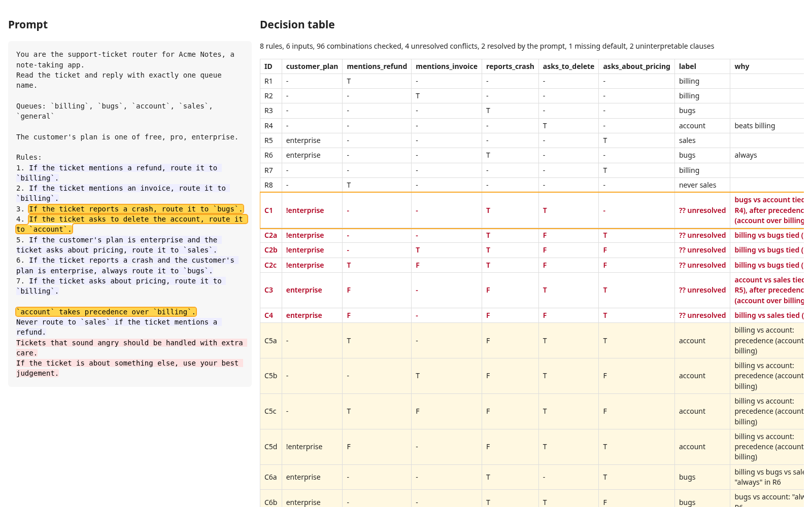

# prompt-decompiler

**Turn a classifier prompt into a decision table you can inspect and test.**

A routing or classification prompt is a small program written in English: "if the ticket mentions a refund, route it to `billing`", "`account` takes precedence over `billing`". prompt-decompiler reads those sentences, checks every combination of the conditions they mention, and shows which label the prompt asks for in each case. It points out where two rules disagree and nothing says which one wins, where no rule applies and there is no default, and which sentences it could not read at all. It never guesses: an undecided case stays `?? unresolved` until you decide it, and your decisions are saved to a file next to the prompt.

It then exports one test case per rule, conflict and gap, as JSONL or as a [promptfoo](https://www.promptfoo.dev/) test file, so the cases the prompt leaves unclear become tests you can run against your model.

The parser is deterministic and offline. It pattern-matches sentences and never calls a model, so the same prompt always gives the same table. It also means it only understands the phrasings listed under [What it understands](#what-it-understands).



## Install

prompt-decompiler is not published to npm. Run it from a clone (Node 20 or newer):

```sh
git clone https://github.com/jatingargiitk/prompt-decompiler
cd prompt-decompiler
npm ci && npm run build
node dist/cli.js examples/support-router.md
```

The examples below write `prompt-decompiler` for `node dist/cli.js`; `npm link` puts that command on your PATH.

## Example

[`examples/support-router.md`](examples/support-router.md) is a made-up support router for a made-up note-taking app:

```markdown
You are the support-ticket router for Acme Notes, a note-taking app.
Read the ticket and reply with exactly one queue name.

Queues: `billing`, `bugs`, `account`, `sales`, `general`

The customer's plan is one of free, pro, enterprise.

Rules:
1. If the ticket mentions a refund, route it to `billing`.
2. If the ticket mentions an invoice, route it to `billing`.
3. If the ticket reports a crash, route it to `bugs`.
4. If the ticket asks to delete the account, route it to `account`.
5. If the customer's plan is enterprise and the ticket asks about pricing, route it to `sales`.
6. If the ticket reports a crash and the customer's plan is enterprise, always route it to `bugs`.
7. If the ticket asks about pricing, route it to `billing`.

`account` takes precedence over `billing`.
Never route to `sales` if the ticket mentions a refund.
Tickets that sound angry should be handled with extra care.
If the ticket is about something else, use your best judgement.
```

`prompt-decompiler examples/support-router.md` prints:

```text
support-router.md  (sha256 d80bef5599bf)

Inputs
  A  customer_plan       customer's plan: free | pro | enterprise  L6
  B  mentions_refund     the ticket mentions a refund  L9
  C  mentions_invoice    the ticket mentions an invoice  L10
  D  reports_crash       the ticket reports a crash  L11
  E  asks_to_delete      the ticket asks to delete the account  L12
  F  asks_about_pricing  the ticket asks about pricing  L13

Decision table
  ID   A            B  C  D  E  F  → label        why                                                                      source
  R1   -            T  -  -  -  -  billing                                                                                 L9
  R2   -            -  T  -  -  -  billing                                                                                 L10
  R3   -            -  -  T  -  -  bugs                                                                                    L11
  R4   -            -  -  -  T  -  account        beats billing                                                            L12
  R5   enterprise   -  -  -  -  T  sales                                                                                   L13
  R6   enterprise   -  -  T  -  -  bugs           always                                                                   L14
  R7   -            -  -  -  -  T  billing                                                                                 L15
  R8   -            T  -  -  -  -  never sales                                                                             L18
  ·
  C1   !enterprise  -  -  T  T  -  ?? unresolved  bugs vs account tied (R3, R4), after precedence (account over billing)   L11 L12 L17
  C2a  !enterprise  -  -  T  F  T  ?? unresolved  billing vs bugs tied (R3, R7)                                            L11 L15
  C2b  !enterprise  -  T  T  F  F  ?? unresolved  billing vs bugs tied (R2, R3)                                            L10 L11
  C2c  !enterprise  T  F  T  F  F  ?? unresolved  billing vs bugs tied (R1, R3)                                            L9 L11
  C3   enterprise   F  -  F  T  T  ?? unresolved  account vs sales tied (R4, R5), after precedence (account over billing)  L12 L13 L15 L17
  C4   enterprise   F  -  F  F  T  ?? unresolved  billing vs sales tied (R5, R7)                                           L13 L15
  C5a  -            T  -  F  T  T  account        billing vs account: precedence (account over billing)                    L9 L12 L15 L17
  C5b  -            -  T  F  T  F  account        billing vs account: precedence (account over billing)                    L10 L12 L17
  C5c  -            T  F  F  T  F  account        billing vs account: precedence (account over billing)                    L9 L12 L17
  C5d  !enterprise  F  -  F  T  T  account        billing vs account: precedence (account over billing)                    L12 L15 L17
  C6a  enterprise   -  -  T  -  T  bugs           billing vs bugs vs sales: "always" in R6                                 L11 L13 L14 L15
  C6b  enterprise   -  -  T  T  F  bugs           bugs vs account: "always" in R6                                          L11 L12 L14
  C6c  enterprise   -  T  T  F  F  bugs           billing vs bugs: "always" in R6                                          L10 L11 L14
  C6d  enterprise   T  F  T  F  F  bugs           billing vs bugs: "always" in R6                                          L9 L11 L14
  G1   -            F  F  F  F  F  ?? unresolved  no rule applies and the prompt has no default

Could not interpret
  L19    "Tickets that sound angry should be handled with extra care."
         no label in the action part
  L20    "If the ticket is about something else, use your best judgement."
         no label in the action part

Notes
  - Rules are numbered, but the prompt never says they apply in order, so numbering is not used as priority.

8 rules, 6 inputs, 96 combinations checked, 4 unresolved conflicts, 2 resolved by the prompt, 1 missing default, 2 uninterpretable clauses
```

How to read it:

- **Inputs** are the conditions the rules test, each with a column letter. `customer_plan` is a fixed-choice input because line 6 declares its values. The others are yes/no.
- **R rows** are the rules as read. `-` means any value and `!enterprise` means anything but enterprise. R8 is a prohibition, so it shows `never sales`.
- **C rows** are combinations where more than one label applies. The prompt itself settles `C5` (the precedence sentence on line 17) and `C6` ("always" in rule 6). It does not settle `C1` to `C4`: for a free-plan ticket that reports a crash *and* asks to delete the account, rules 3 and 4 both apply and nothing says which wins. Lettered rows (`C2a`, `C2b`, ...) are one conflict split into pieces that fit in `-` cells.
- **G rows** are gaps. With every condition false, no rule applies and the prompt has no default.
- **Could not interpret** lists sentences that look like instructions but don't name a label. "Use your best judgement" is not a default.

## Deciding the open cases

`review` walks through every extracted rule, then every open conflict, then the default, and writes your answers to a decisions file. This is a real session, with the questions for R2 to R8 cut:

```text
$ prompt-decompiler review examples/support-router.md --confirm examples/support-router.decisions.yaml
Reviewing 8 extracted rules (8 not yet confirmed).

R1  L9  "If the ticket mentions a refund, route it to `billing`."
    read as: billing when mentions_refund=T
    Is this right? [y]es / [n]o, drop it / [q]uit: y

...

Conflict: bugs vs account (16 combinations), e.g.
    customer_plan=free mentions_refund=false mentions_invoice=false reports_crash=true asks_to_delete=true asks_about_pricing=false
    R3 L11: "If the ticket reports a crash, route it to `bugs`."
    R4 L12: "If the ticket asks to delete the account, route it to `account`."
    Which label should win? [1] bugs / [2] account / [s]kip / [q]uit: 2

Conflict: billing vs bugs (14 combinations), e.g.
    customer_plan=free mentions_refund=true mentions_invoice=false reports_crash=true asks_to_delete=false asks_about_pricing=false
    R1 L9: "If the ticket mentions a refund, route it to `billing`."
    R3 L11: "If the ticket reports a crash, route it to `bugs`."
    Which label should win? [1] billing / [2] bugs / [s]kip / [q]uit: 2

Conflict: account vs sales (2 combinations), e.g.
    customer_plan=enterprise mentions_refund=false mentions_invoice=false reports_crash=false asks_to_delete=true asks_about_pricing=true
    R4 L12: "If the ticket asks to delete the account, route it to `account`."
    R5 L13: "If the customer's plan is enterprise and the ticket asks about pricing, route it to `sales`."
    Which label should win? [1] account / [2] sales / [s]kip / [q]uit: 1

Conflict: billing vs sales (2 combinations), e.g.
    customer_plan=enterprise mentions_refund=false mentions_invoice=false reports_crash=false asks_to_delete=false asks_about_pricing=true
    R5 L13: "If the customer's plan is enterprise and the ticket asks about pricing, route it to `sales`."
    R7 L15: "If the ticket asks about pricing, route it to `billing`."
    Which label should win? [1] billing / [2] sales / [s]kip / [q]uit: 2

3 combinations match no rule and the prompt has no default.
    Default label? [1] billing / [2] bugs / [3] account / [4] sales / [5] general / [s]kip: 5

Saved /tmp/my.yaml. 8 rules, 6 inputs, 96 combinations checked, 0 unresolved conflicts, 6 resolved by the prompt or decisions, 0 missing defaults, 2 uninterpretable clauses
```

If you stop partway, run it again later and it only asks about what is still open. The file is plain YAML that you can edit by hand and review in a pull request. This is the file the session above wrote, [`examples/support-router.decisions.yaml`](examples/support-router.decisions.yaml):

```yaml
# prompt-decompiler decisions. Edit by hand or with `prompt-decompiler review`.
prompt_sha256: d80bef5599bf2c3e96fedae589c87efe4534db4900aaabea07afbbf452e35d54
rules:
  R1: accept
  R2: accept
  R3: accept
  R4: accept
  R5: accept
  R6: accept
  R7: accept
  R8: accept
conflicts:
  - between: [bugs, account]
    winner: account
  - between: [billing, bugs]
    winner: bugs
  - between: [account, sales]
    winner: account
  - between: [billing, sales]
    winner: sales
default: general
```

Pass it with `--confirm` and the table shows how each conflict is now settled:

```text
$ prompt-decompiler examples/support-router.md --confirm examples/support-router.decisions.yaml --check
Decision table
  ID   A            B  C  D  E  F  → label      why                                                                                  source
  R1   -            T  -  -  -  -  billing      confirmed                                                                            L9
  R2   -            -  T  -  -  -  billing      confirmed                                                                            L10
  R3   -            -  -  T  -  -  bugs         confirmed                                                                            L11
  R4   -            -  -  -  T  -  account      beats billing, confirmed                                                             L12
  R5   enterprise   -  -  -  -  T  sales        confirmed                                                                            L13
  R6   enterprise   -  -  T  -  -  bugs         always, confirmed                                                                    L14
  R7   -            -  -  -  -  T  billing      confirmed                                                                            L15
  R8   -            T  -  -  -  -  never sales  confirmed                                                                            L18
  ·
  C1a  -            T  -  F  T  T  account      billing vs account: precedence (account over billing)                                L9 L12 L15 L17
  C1b  -            -  T  F  T  F  account      billing vs account: precedence (account over billing)                                L10 L12 L17
  C1c  -            T  F  F  T  F  account      billing vs account: precedence (account over billing)                                L9 L12 L17
  C1d  !enterprise  F  -  F  T  T  account      billing vs account: precedence (account over billing)                                L12 L15 L17
  C2a  !enterprise  -  -  T  T  T  account      billing vs bugs vs account: precedence (account over billing), then decisions file   L11 L12 L15 L17
  C2b  !enterprise  -  T  T  T  F  account      billing vs bugs vs account: precedence (account over billing), then decisions file   L10 L11 L12 L17
  C2c  !enterprise  T  F  T  T  F  account      billing vs bugs vs account: precedence (account over billing), then decisions file   L9 L11 L12 L17
  C2d  enterprise   F  -  F  T  T  account      billing vs account vs sales: precedence (account over billing), then decisions file  L12 L13 L15 L17
  C3a  enterprise   -  -  T  -  T  bugs         billing vs bugs vs sales: "always" in R6                                             L11 L13 L14 L15
  C3b  enterprise   -  -  T  T  F  bugs         bugs vs account: "always" in R6                                                      L11 L12 L14
  C3c  enterprise   -  T  T  F  F  bugs         billing vs bugs: "always" in R6                                                      L10 L11 L14
  C3d  enterprise   T  F  T  F  F  bugs         billing vs bugs: "always" in R6                                                      L9 L11 L14
  C4a  !enterprise  -  -  T  F  T  bugs         billing vs bugs: decisions file                                                      L11 L15
  C4b  !enterprise  -  T  T  F  F  bugs         billing vs bugs: decisions file                                                      L10 L11
  C4c  !enterprise  T  F  T  F  F  bugs         billing vs bugs: decisions file                                                      L9 L11
  C5   !enterprise  F  F  T  T  F  account      bugs vs account: decisions file                                                      L11 L12
  C6   enterprise   F  -  F  F  T  sales        billing vs sales: decisions file                                                     L13 L15
  ·
  DEF  -            -  -  -  -  -  general      default, confirmed in decisions file

...

8 rules, 6 inputs, 96 combinations checked, 0 unresolved conflicts, 6 resolved by the prompt or decisions, 0 missing defaults, 2 uninterpretable clauses
```

How decisions apply:

- A conflict decision names the tied labels, in any order. It applies wherever exactly those labels are still tied after the prompt's own priorities.
- `R7: reject` under `rules` drops a rule that was misread or that you no longer want. Rejecting a rule can open or close conflicts, so `review` asks about rules first.
- `default` only applies when the prompt has no default of its own.
- `prompt_sha256` records which version of the prompt you reviewed. If the prompt changes you get a warning. A decision that names a rule or label that no longer exists is reported, not silently applied.

`--check` exits 1 while anything is open, so you can run it in CI. In this example it still exits 1 with the decisions file, because two sentences are uninterpretable. That is deliberate: rewrite them so they name a label, or delete them. v0.1 has no setting to silence them.

## Exporting tests

```text
$ prompt-decompiler examples/support-router.md --tests router-tests.yaml
...
Wrote 15 test cases to router-tests.yaml (6 without an expected label).
```

Each rule gets the simplest combination where it decides the answer. Each conflict and gap gets its simplest witness combination, and the default gets one case too. The file extension picks the format: `.yaml` or `.yml` writes a promptfoo test list, anything else writes JSONL. Unresolved cases are marked `UNRESOLVED` and have no assertion:

```yaml
- description: "R1: If the ticket mentions a refund, route it to `billing`."
  vars:
    customer_plan: free
    mentions_refund: true
    mentions_invoice: false
    reports_crash: false
    asks_to_delete: false
    asks_about_pricing: false
    scenario: "customer's plan: free; the ticket mentions a refund: yes; the ticket mentions an invoice: no; the ticket reports a crash: no; the ticket asks to delete the account: no; the ticket asks about pricing: no"
  assert:
    - type: equals
      value: billing
  metadata:
    kind: rule
    status: decided
    why: R1 applies on its own
...
- description: "UNRESOLVED C1: bugs vs account tied after precedence (account over billing); the prompt does not say which wins"
  vars:
    customer_plan: free
    mentions_refund: false
    mentions_invoice: false
    reports_crash: true
    asks_to_delete: true
    asks_about_pricing: false
    scenario: "customer's plan: free; the ticket mentions a refund: no; the ticket mentions an invoice: no; the ticket reports a crash: yes; the ticket asks to delete the account: yes; the ticket asks about pricing: no"
  metadata:
    kind: conflict
    status: unresolved
    why: bugs vs account tied after precedence (account over billing); the prompt does not say which wins
```

The `vars` are the decision-table inputs, not ticket text, so you still write the input for each case, by hand or from a template using `scenario` or the individual vars. With the decisions file applied, all 15 cases get an expected label.

JSONL has the same fields, one case per line:

```json
{"id":"R1","kind":"rule","inputs":{"customer_plan":"free","mentions_refund":true,"mentions_invoice":false,"reports_crash":false,"asks_to_delete":false,"asks_about_pricing":false},"expected":"billing","status":"decided","why":"R1 applies on its own","source":[{"line":"L9","text":"If the ticket mentions a refund, route it to `billing`."}]}
```

## Formats

```text
prompt-decompiler <prompt-file | -> [options]
prompt-decompiler review <prompt-file> --confirm <decisions.yaml>

-f, --format <fmt>        table (default), markdown, json or html
-o, --output <file>       write the table there instead of stdout
-c, --confirm <file>      apply a decisions file (YAML or JSON)
    --tests <file>        write one test case per rule, conflict and gap
    --tests-format <fmt>  jsonl or promptfoo (default: promptfoo for .yaml/.yml, else jsonl)
    --check               exit 1 if any conflict, missing default or clause is left unresolved
    --max-combinations <n>  enumeration limit (default 65536)
    --no-color            plain output (also NO_COLOR=1)
```

- `table` is the terminal view above, in colour when stdout is a terminal.
- `markdown` is the same table, for a pull request or a doc.
- `json` holds the parsed model, every row with its source spans, the conflicts with witnesses, the gaps and the summary.
- `html` is a single self-contained file with no external scripts or styles. It shows the prompt on the left and the table on the right, and clicking a row highlights the sentences behind it. The screenshot at the top is this output for the example, with row C1 clicked.

Exit codes are 0 for ok, 1 when `--check` finds open issues, and 2 for a usage or input error. Pass `-` to read the prompt from stdin.

## What it understands

- **Labels** come from a line such as `Labels: a, b, c`, `Queues: ...` or `Categories are ...`, or from a list of `` `label` `` or `label: description` items under that line.
- **Rules** are `If/When <conditions>, <route|label|classify|tag|...> it <label>`, `<action> <label> if/when/unless <conditions>`, or `Messages that <condition> should go to <label>`. Conditions joined by `and` share one row. Conditions joined by `or` get one row each (`R1a`, `R1b`).
- **Inputs:** each distinct condition becomes a yes/no input. `the plan is enterprise` becomes a fixed-choice input when the prompt declares the values (`The customer's plan is one of free, pro, enterprise`) or when several rules test the same subject against different values.
- **Negation:** `not`, `doesn't`, `isn't` and `unless` flip a condition.
- **Prohibitions** are written as `Never route to <label> if ...` or `Do not label it <label> when ...`.
- **Priorities** apply in this order:
  1. `always` (or `regardless`, `no matter what`) in a rule.
  2. Numbered order, but only when the prompt says so (`Apply the rules in order`, `the first match wins`). Without such a sentence a numbered list is not treated as ordered, and the table's notes say so.
  3. Precedence between labels or rule numbers: `<a> takes precedence over <b>`, `<a> overrides <b>`, `prefer <a> over <b>`.
- **Defaults** are `Otherwise, ...`, `If nothing else applies, ...`, `By default, ...`, `The default label is ...` or `Fall back to ...`.

Anything else that looks like an instruction goes under "Could not interpret", with a reason.

## Limitations

- **It is a heuristic parser.** It matches sentence patterns and does not understand language. A rule worded differently from the list above is either missed (usually shown as uninterpretable) or misread. That is why `review` asks you to confirm every rule before you rely on the table.
- **Conditions are compared as text.** "mentions a refund" and "asks for their money back" become two separate inputs. Fixed-choice inputs are only detected from `is one of` or `X is a` / `X is b` wording, and the values of one subject are assumed to exclude each other. An inferred choice input also gets an `(other)` value for "none of the values mentioned".
- **Inputs are treated as independent.** Every combination is checked, including some that cannot happen in practice, such as a ticket where "mentions a refund" is true but a separate "is about money" condition is false. You can skip those conflicts in `review`.
- **Enumeration is exhaustive and capped** at 65,536 combinations (16 yes/no inputs) by default. A larger prompt stops with an error instead of a partial table. `--max-combinations` raises the cap.
- **Priorities are limited** to `always`, explicit rule order, and precedence between labels or rule numbers. A sentence like "security issues are more important than anything else" is not understood.
- **There is no LLM mode.** v0.1 is deterministic only. A model-assisted parser for free-form prompts is an idea for later, not something this version does.
- **One label per input.** Multi-label classifiers, scores and free-text outputs are out of scope.
- **Exported tests need inputs.** A test case says which conditions should hold, not what the ticket says, so you still write the text, or a template, for each case.

## Related work

- [rule-audit](https://github.com/roli-lpci/rule-audit) is a static Python analyzer for AI system prompts. It finds contradictions, coverage gaps and priority ambiguities between rules, and is aimed at general agent instructions such as `CLAUDE.md` and `AGENTS.md`. prompt-decompiler covers a narrower case, classifier and routing prompts, and adds a decision table, a decisions file and test export.
- [PromptViz](https://github.com/tiwari85aman/PromptViz) uses an LLM to turn a system prompt into an interactive diagram of its logic.
- [WIRE: Profiling Witnessed Within-Policy Instruction Collisions in LLM Agents](https://arxiv.org/abs/2605.27784) studies collisions between instructions in agent policies and backs each one with a concrete witness. The witness test cases here apply the same idea on a much smaller scale.

## Development

```sh
npm ci
npm run lint   # eslint and tsc
npm test       # vitest
npm run build
```

## License

[MIT](LICENSE)
